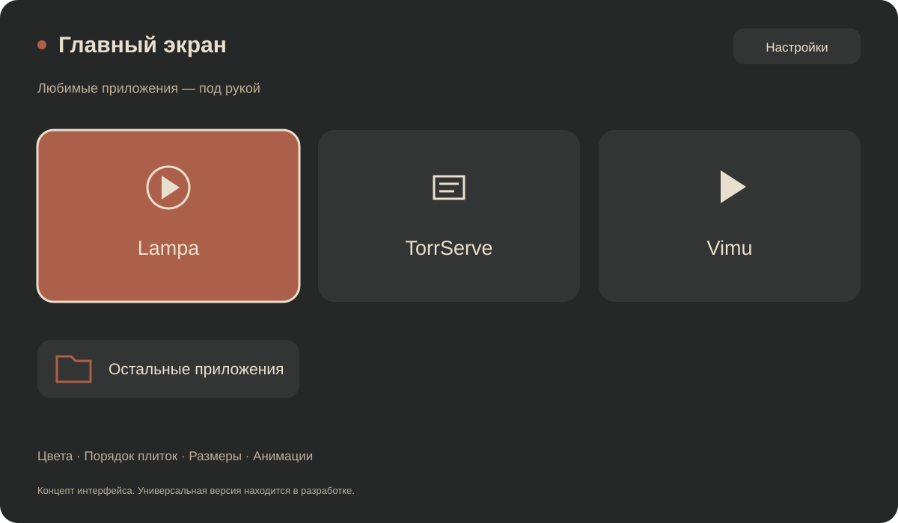

# TV Setup

Мастер настройки медиаприложений и минималистичного интерфейса для ТВ-устройств.

Это публичная витрина проекта. Здесь представлены концепция, планируемые возможности и статусы платформ. Рабочие исходники, установочные пакеты и данные активации не публикуются. Доступ к продукту согласовывается отдельно.



*Концепт интерфейса. Иллюстрация не подтверждает готовность универсального установщика.*

## Зачем нужен проект

Настройка ТВ-устройства часто требует отдельно найти подходящие версии приложений, связать клиент с локальным сервером, выбрать плеер и настроить главный экран. Проект объединяет эти действия в последовательный мастер с управлением пультом, понятными подтверждениями и сохранением существующих данных.

Цель — сократить ручную настройку и дать пользователю управляемый интерфейс без обязательного компьютера и root-доступа. Конкретный объём автоматизации будет подтверждаться на поддерживаемых устройствах.

## Что планируется

- Один мастер установки Lampa, TorrServe MatriX и Vimu для совместимых Android-устройств.
- Добровольная замена главного экрана с предварительным просмотром.
- Три основные плитки и папка «Остальные приложения» с уже установленными программами.
- Настраиваемые цвета, порядок, размеры плиток и анимации.
- Управление пультом, сохранение существующих данных и согласование перенастройки.
- Локальная медиасвязка на поддерживаемом устройстве.

Сторонние приложения и сервисы имеют собственные условия использования и распространения. Наличие приложения в плане не означает включения лицензии на него в доступ к этому проекту.

## Платформы

| Платформа | Статус |
| --- | --- |
| [Android TV / Google TV](platforms/android/README.md) | Первая целевая платформа. Есть индивидуальный прототип интерфейса; универсальный мастер проектируется |
| [LG webOS](platforms/lg-webos/README.md) | Исследование возможностей |
| [Samsung Tizen](platforms/samsung-tizen/README.md) | Исследование возможностей |

Поддержка конкретной модели и функции подтверждается отдельно. Общая готовность для всех устройств не заявляется.

## Структура и требования

```text
docs/                      концепция, требования, архитектура и доступ
platforms/android/         Android TV, Google TV и совместимые Android-устройства
platforms/lg-webos/         отдельное направление LG webOS
platforms/samsung-tizen/    отдельное направление Samsung Tizen
.github/ISSUE_TEMPLATE/    форма запроса доступа
LICENSE                    условия использования собственных материалов
```

- [Требования первой версии](docs/REQUIREMENTS.md)
- [Архитектура и границы платформ](docs/ARCHITECTURE.md)
- [Сценарий работы и оформление](docs/FEATURES.md)

Этот репозиторий описывает продукт и не содержит его готовую реализацию. Разделы LG и Samsung пока являются направлениями исследования.

## Как получить доступ

Ознакомьтесь с [порядком запроса доступа](docs/ACCESS.md). В обращении укажите платформу, желаемые функции и сценарий использования без персональных данных.

## Условия

Материалы не предоставляются по открытой лицензии. Условия приведены в [LICENSE](LICENSE). Публичное размещение позволяет ознакомиться с проектом; доступ к рабочему продукту и разрешение на его использование требуют отдельной договорённости. Просмотр и форки на GitHub регулируются также условиями платформы.
